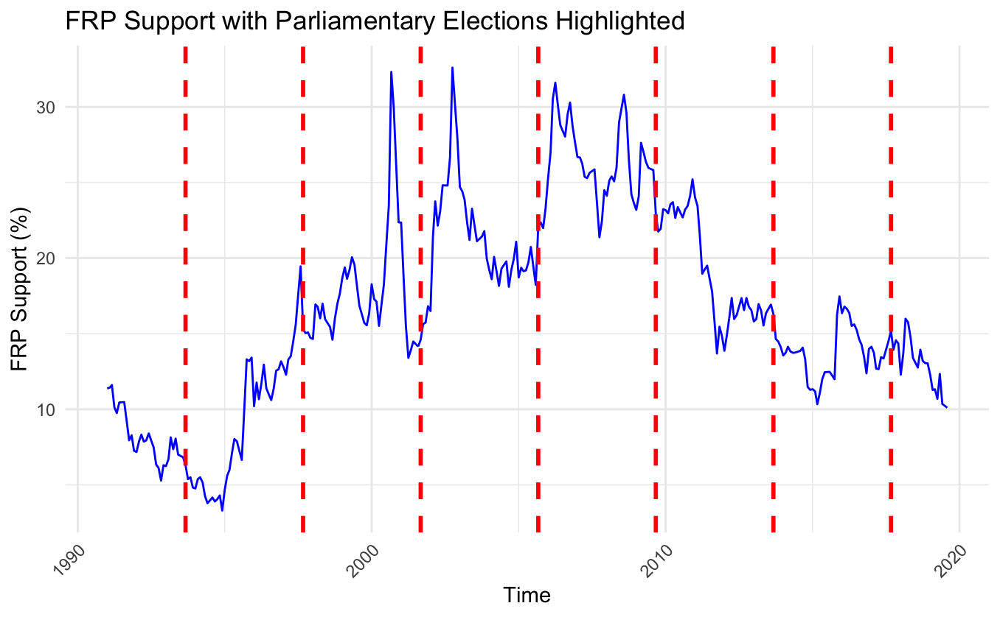
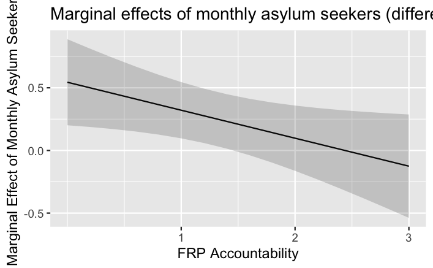
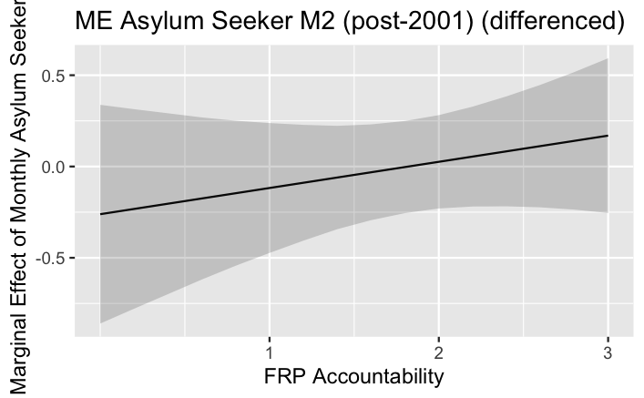

# What drives support for Norway's Progress Party? A replication with structural breaks

My final project for Topics in Applied Econometrics (EC2011) at the University of Leicester, spring 2025. It was set as a group project; I did it alone.

It replicates Haugsgjerd and Bergh, "Explaining the surge of the populist radical right: A time-series analysis of the effects of immigration and the economy in Norway" (*Political Behavior*, 2024), and extends it with structural-break analysis.

> How did economic performance and immigration influence support for the Norwegian Progress Party (FrP) between 1991 and 2019?

- **Report (PDF):** [report/Saldan_2025_FRP_replication.pdf](report/Saldan_2025_FRP_replication.pdf)
- **Analysis code (R Markdown):** [analysis/analysis.Rmd](analysis/analysis.Rmd)

## Data

These are monthly series from January 1991 to August 2019, from the authors' replication files:

- FrP support in opinion polls;
- unemployment;
- the Oslo Stock Exchange index (OBX);
- newly arrived asylum seekers;
- a measure of how long the FrP had been in government, and so how far it could be held accountable.

The dataset is [Haugsgjerd and Bergh's replication data on Harvard Dataverse](https://doi.org/10.7910/DVN/538GK3), released under CC0 (public domain). A copy is included in [`data/`](data/), so the analysis runs as it is.

## Method

**Replication.** I re-estimated the authors' four autoregressive distributed lag (ADL) models by OLS. Each model has two monthly lags of FrP support and of the predictors, and all variables are standardised so the coefficients can be compared.

**Extensions:**
1. **Misspecification tests** for normality, linearity, homoskedasticity and autocorrelation. Autocorrelation was checked with the Breusch–Godfrey test.
2. **Lag length re-checked** with AIC and BIC across 1–12 lags. Two lags came out best, as in the original paper.
3. **Structural breaks.** I ran the Quandt–Andrews test (a Chow test at every possible break date) and split the sample recursively at the strongest significant break. It stopped when no break was significant or a sub-sample would drop below 30 observations. Breaks appeared around **2001** and **2005**.
4. **Explaining the breaks.** I matched the break dates to changes in the party:
    - **2001:** after the 2001 election, the FrP expelled a group of its most radical leaders as it tried to become an acceptable coalition partner.
    - **2005:** around the 2005 election, it broadened from an anti-tax protest party towards welfare issues such as elder care.

    I then re-estimated the models before and after the breaks.

## Findings

- **The original findings hold.** Economic good times (low unemployment, rising stocks) and higher asylum numbers both raise FrP support in the short run.
- **The breaks add nuance.**
    - Before 2001, asylum inflows and stock-market gains gave the FrP immediate boosts.
    - After 2005, the asylum effect fades towards zero and sometimes turns negative after two months.
    - This fits a party that was already being held responsible for immigration policy before it formally entered government in 2013.

## Running it

Open `analysis/analysis.Rmd` in RStudio with the `analysis/` folder as the working directory and knit it. The packages it needs are listed at the top of the file, among them `dynlm`, `strucchange`, `lmtest`, `sandwich` and `marginaleffects`.

The code is published as it was used for the report, apart from the data path.

## Reference

Haugsgjerd, A., & Bergh, J. (2024). Explaining the surge of the populist radical right: A time-series analysis of the effects of immigration and the economy in Norway. *Political Behavior*, 46, 1633–1652.
